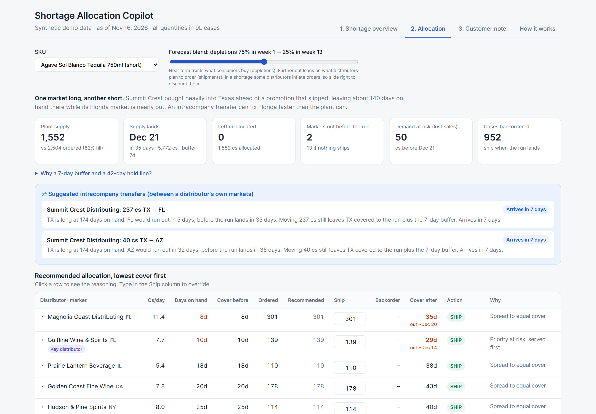
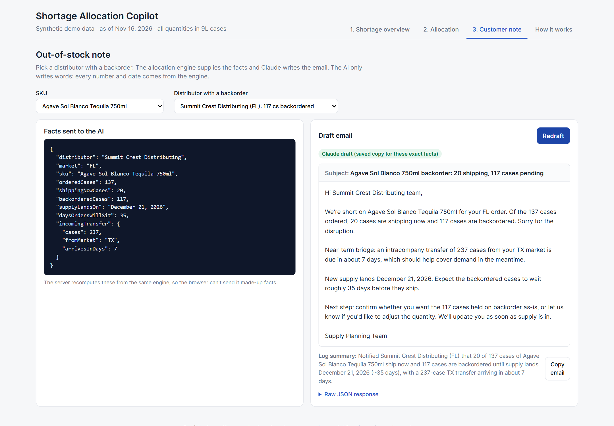
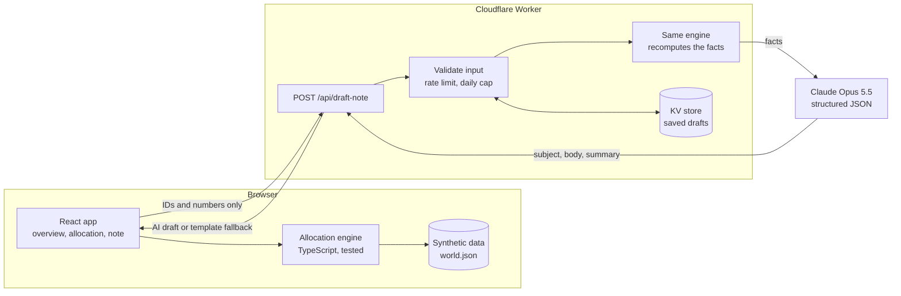

# Shortage Allocation Copilot

**When there isn't enough to go around, who ships, who waits, and how do you tell them?**

A working demo of how a supply planner allocates scarce inventory across distributors during a shortage, then drafts the customer communication. Every recommendation shows its reasoning. No black box.

**[Live demo →](https://shortage-copilot.reedholmes9.workers.dev)** · Built by Reed Holmes, supply chain planner (6 years in CPG, wine and spirits). All companies, brands and numbers are synthetic.



## The problem

A production run slips, or demand spikes ahead of the holidays, and suddenly open orders exceed what the plant can ship. The planner has to decide, distributor by distributor, who ships in full, who gets a partial, and who waits for the next run. Get it wrong and a market stocks out while another sits on 90 days of inventory.

In practice this lives in spreadsheets, gut feel and long email threads. The logic is rarely written down, so it's hard to explain to sales, to the distributors, or to the next planner. This tool writes the method down, applies it consistently, and shows its work on every line.

## Try it in two minutes

1. **Shortage overview:** three of eight SKUs are short. Each card shows the gap, when supply lands, and how many markets run out before then, with and without the plan.
2. **Open the tequila scenario:** Summit Crest is long in Texas (about 170 days on hand) and nearly out in Florida. The engine suggests an intracompany transfer before spending plant supply.
3. **Click any row** to read why it ships, waits or gets a partial.
4. **Type a different Ship quantity.** The rest of the supply re-spreads and the tiles show the cost of your override in lost sales.
5. **Move the forecast blend slider** and watch the plan change when you trust depletions over (inflated) orders.
6. **Customer note:** pick a backordered distributor and have Claude draft the out-of-stock email.

## The method

This is my real allocation method, implemented in [`src/engine/allocation.ts`](src/engine/allocation.ts) and covered by tests.

| Step | Rule |
|---|---|
| 1. Blend forecasts | Depletions (what consumers buy) carry the most weight near term, shipments (what distributors plan to order) further out. Default: 75% depletions in week 1 sliding to 25% by week 13, adjustable in the app |
| 2. Days on hand | On hand plus in-transit arriving within 7 days, divided by average daily blended demand. Later arrivals count toward reaching the next run, but not as stock on the floor |
| 3. Flag backorders | Any open order the shortage can't fill is backordered until the next run, earliest requested ship week filled first |
| 4. Rank | Markets ranked by days of cover, lowest first |
| 5. Hold | Orders are held for markets already covered to the next run plus a safety buffer. Buffer: 7 days, +3 for top-quartile volume SKUs, +4 for volatile demand (week-to-week variation above 30%) |
| 6. Ship | Priority accounts (national accounts, key distributors) jump the line **only if they would stock out before the run**. Everything left is spread so low-cover markets rise together toward equal days of cover, never above what they ordered |
| 7. Transfer | If one of a distributor's markets is long (over 90 days) and another would stock out, suggest an intracompany transfer with a 1-week lead time. The long market keeps enough to reach the run plus buffer |


### Design choices worth calling out

- **Equal days of cover, not equal fill rate.** Filling everyone to the same percentage of their order rewards whoever ordered the most. Spreading supply toward equal days of cover protects the markets closest to running out.
- **Priority only when it matters.** A national account with 60 days on hand doesn't need to jump the line. Priority kicks in when that account would actually stock out.
- **Lost sales, not just backorders.** Total backorders don't change when you move supply between customers, so the app also shows *demand at risk*: cases consumers can't buy before supply lands. That's the number an override actually moves.
- **Why the forecast blend matters.** In a shortage some distributors inflate orders to win a bigger allocation. Leaning on depletions near term discounts that. In the demo data, trusting depletions instead of orders cuts lost sales by up to two thirds with the same supply.

## The AI customer note



Claude (Opus 5.5) drafts the out-of-stock email: what's short, what ships now, when supply lands, and how long backordered cases will wait. It returns structured JSON (`subject`, `body`, `summary`) enforced by the API.

**The AI writes words, never numbers.** Every quantity and date comes from the allocation engine, and the model is told to use only those facts.

Guardrails, because this is a public demo:

- **No free text reaches the model.** The browser sends only IDs and numbers. The server validates them and recomputes the facts itself with the same engine, so a visitor can't inject instructions or fake figures.
- **API key stays server side** as an encrypted Cloudflare secret. It is never in the browser or this repo.
- **Rate limits:** 5 AI drafts per visitor per minute and a site-wide daily cap.
- **Saved drafts:** identical facts reuse a stored draft for 7 days (instant and free).
- **Graceful fallback:** if a limit is hit or the AI is unavailable, the app shows a template email built from the same facts, clearly labeled.

## Architecture



| Piece | Choice | Why |
|---|---|---|
| Front end | React + Vite + TypeScript | Overrides recalculate instantly because the engine runs in the browser |
| Allocation logic | Plain TypeScript module with Vitest tests | Readable, testable, and shared by the browser and the server |
| Server | One Cloudflare Worker serving the app and `/api` | Free tier, one deploy, keeps the API key off the client |
| AI | Claude Opus 5.5 via the Anthropic SDK, structured outputs | Reliable JSON, strong writing, server-side refusal fallback |
| Storage | Cloudflare KV | Saved drafts and the daily counter. No database needed |
| Data | Seed script → JSON file | 100% synthetic and reproducible |

## The demo data

Generated by [`scripts/seed.ts`](scripts/seed.ts) with a fixed random seed: 8 SKUs, 25 distributor markets across 12 states, 13 weekly buckets, all in 9L cases. Three scenarios are built in:

| Scenario | What's going on |
|---|---|
| National bourbon shortage | A bottling outage leaves supply for about 58% of orders, next run in 6 weeks. Some markets nearly dry, others well stocked |
| One market long, another short | Summit Crest over-bought tequila in Texas for a promotion that slipped, while its Florida market is nearly out |
| Holiday sparkling crunch | Holiday demand well above plan, about 55% fill, two national-account markets close to stocking out |

## Assumptions and limits

- **Intracompany transfers are assumed permitted.** In beverage alcohol, moving product between a distributor's state markets usually requires label registration and tax handling in both states.
- Plant shipments are treated as arriving immediately. Transit time from plant to distributor isn't modeled.
- Demand is an average over the window to the next run plus buffer, not a day-by-day simulation.
- One SKU is allocated at a time. No substitution between SKUs or sizes.
- Synthetic data only. No real companies, customers or volumes.

## What's next

- **Real data connectors:** ERP open orders, distributor depletion feeds, production schedule.
- **Allocation policies:** contractual allocation percentages, minimum-ship rules, and a fair-share mode to compare against equal days of cover.
- **Multi-SKU and substitution:** offer a different size or a sister SKU when the ordered one is short.
- **Scenario save and compare:** keep the recommended plan and the planner's version side by side for sign-off.
- **Send through the planner's email**, with an approval step, and log what was sent.
- **Evaluate the AI drafts** against a rubric (facts correct, tone, length) before changing the prompt or model.

## Run it locally

```bash
npm install
npm run dev          # app + API at http://localhost:5173 (API falls back to the template without a key)
npm test             # allocation engine and API guardrail tests
npm run seed         # regenerate the synthetic data
npm run report       # planner-readable review in docs/allocation-review.md
npm run screenshots  # refresh the README images from the live site
npm run deploy       # build and deploy to Cloudflare
```

To enable AI drafts in your own deployment, store a key with `npx wrangler secret put ANTHROPIC_API_KEY`.
