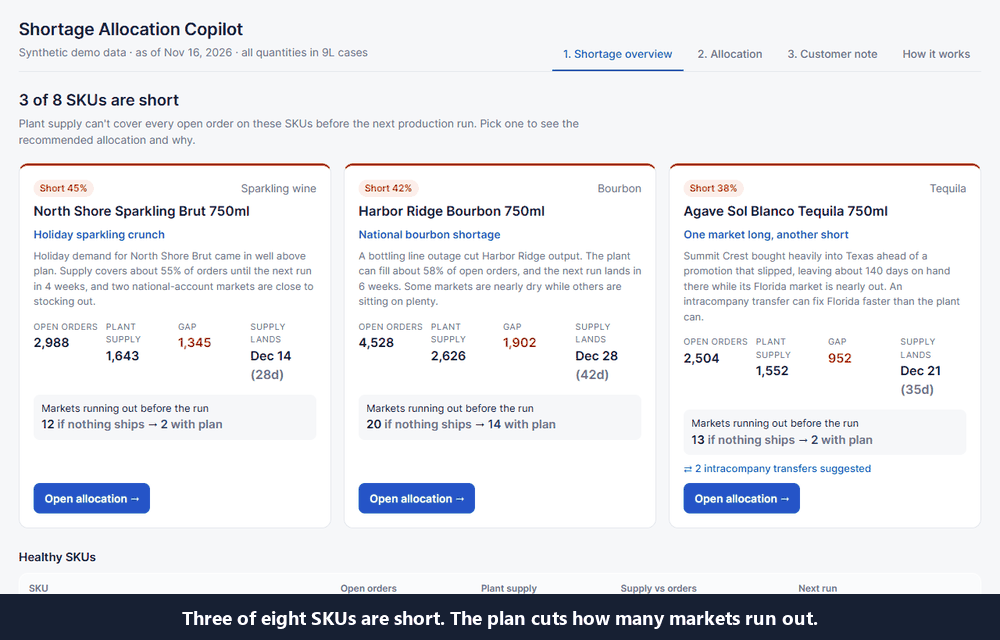
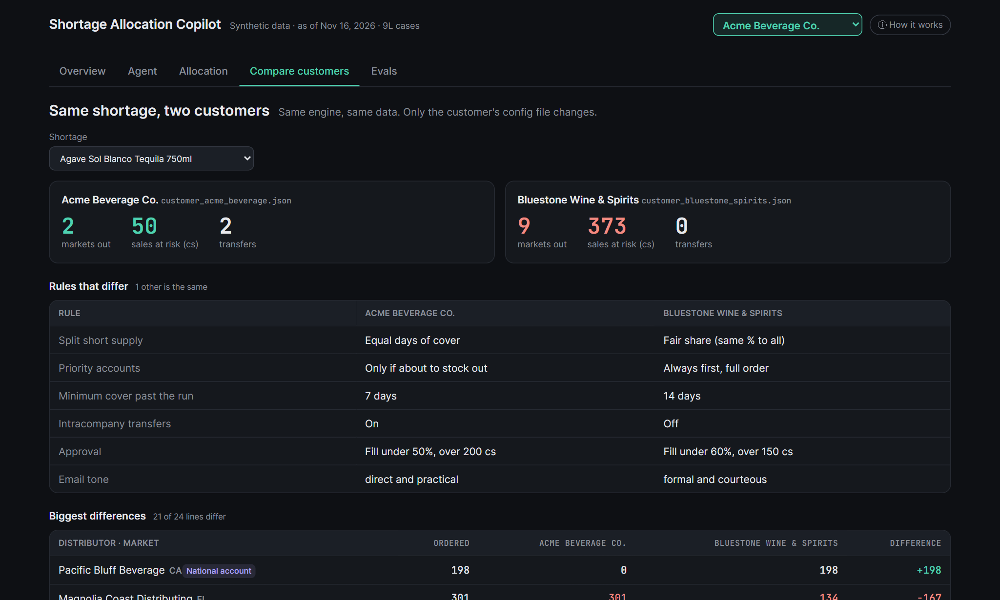
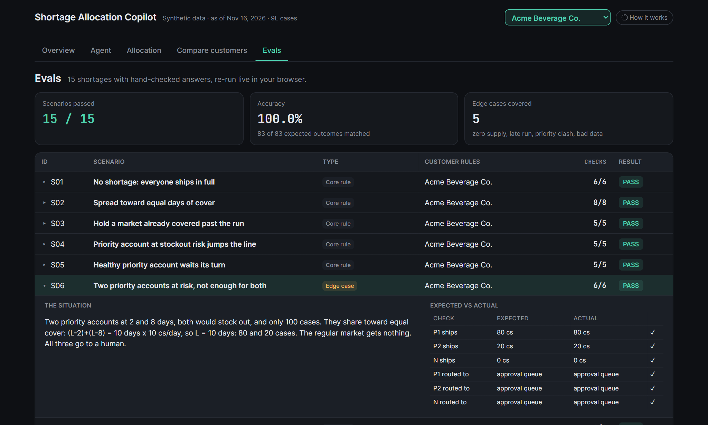
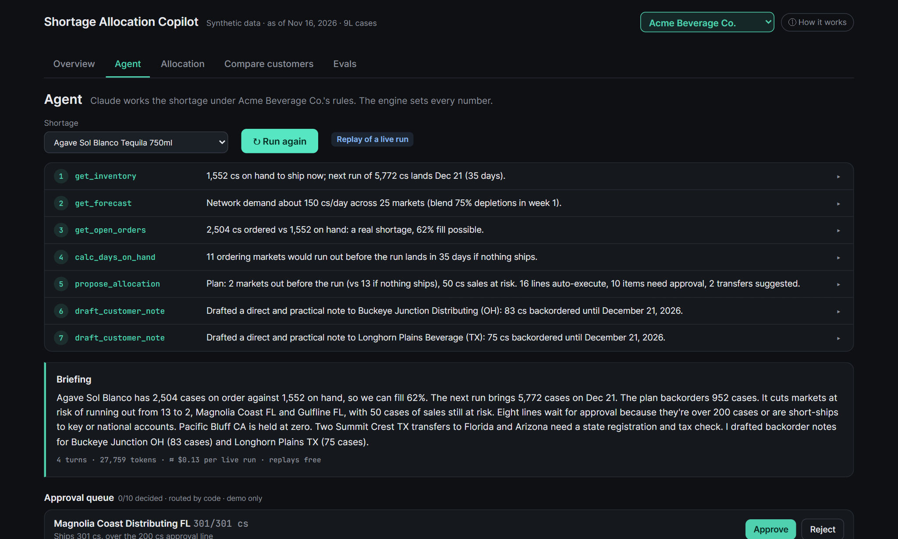
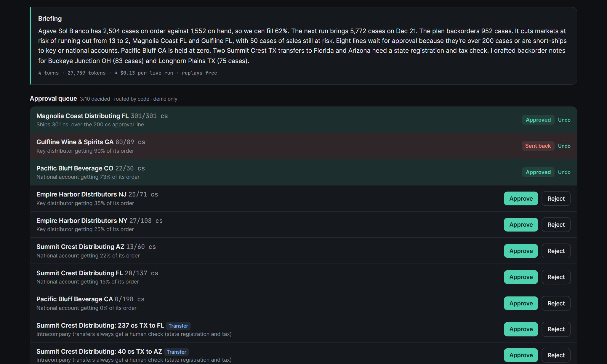
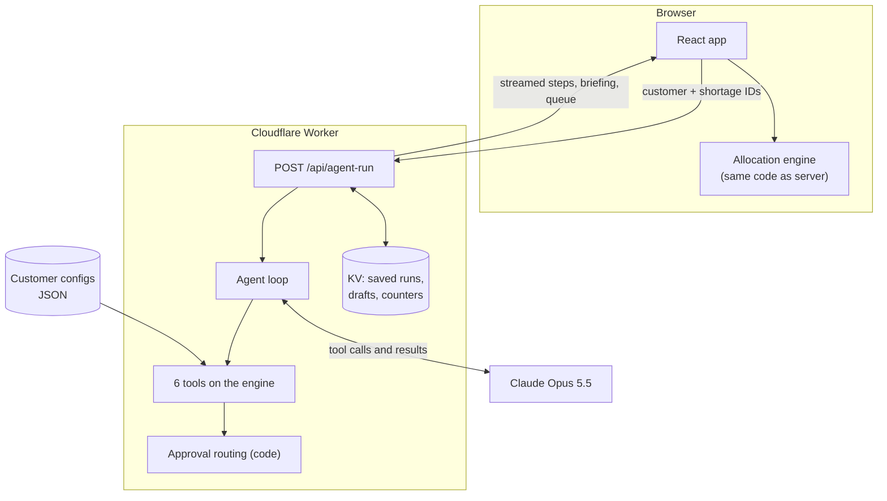
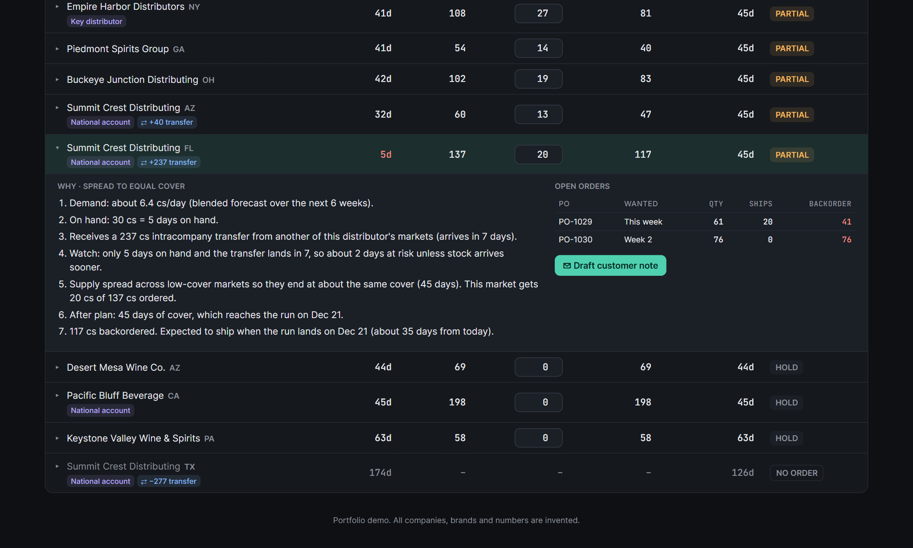

# Shortage Allocation Copilot

**An AI agent that works a supply shortage the way a planner would, configured per customer, tested before it ships, with a person approving the hard calls.**

**[Live demo →](https://shortage-copilot.reedholmes9.workers.dev)** · Built by Reed Holmes, supply chain planner (7 years in CPG supply chain). All companies, brands and numbers are synthetic.

## The problem

A production run slips or demand spikes, and open orders exceed what's on hand. Someone has to decide, distributor by distributor, who ships in full, who gets a partial and who waits for the next available supply, then tell each of them. Today that lives in spreadsheets, phone calls and email threads. The rules are in one planner's head, decisions take days, and nobody can explain afterward why one market got stock and another ran dry.

This project turns that standard operating procedure into an agent workflow a deployment lead can configure for a customer.



## Same shortage, two customers

Each customer's operating rules live in a config file, not in code: [`customer_acme_beverage.json`](config/customer_acme_beverage.json) and [`customer_bluestone_spirits.json`](config/customer_bluestone_spirits.json). Same engine, same data, different rules:

| Rule | Acme Beverage | Bluestone Wine & Spirits |
|---|---|---|
| Split short supply | Equal days of cover, lowest first | Fair share: same % of every order |
| Priority accounts | Only if about to stock out | Always first, full order |
| Minimum cover past the run | 7 days | 14 days |
| Intracompany transfers | On | Off (state rules) |
| Email tone | Direct and practical | Formal and courteous |

| Shortage | Markets out before next supply (Acme vs Bluestone) | Sales at risk, cases (Acme vs Bluestone) |
|---|---|---|
| Agave Sol tequila | **2** vs 9 | **50** vs 373 |
| North Shore sparkling | **2** vs 4 | **126** vs 178 |
| Harbor Ridge bourbon | 14 vs **11** | **819** vs 1,388 |

The contract rule (fair share) costs about 7 times the sales at risk on tequila. On bourbon it leaves fewer markets dry but loses far more sales. A config makes that trade-off visible to the customer before go-live.



## Tested before it ships

[15 shortage scenarios](evals/scenarios), each with the answer worked out by hand and signed off by a planner before the engine ever ran it. `npm run evals` prints the [scorecard](evals/scorecard.md) and fails if anything breaks.

| Type | Scenarios | What they cover |
|---|---|---|
| Core rules | 6 | No shortage, equal days of cover, hold covered markets, priority at risk, healthy priority waits, intracompany transfer |
| Customer rules | 4 | Fair share, the same event under Acme, priority always first, transfers switched off |
| Edge cases | 5 | Two priority accounts fighting for stock, zero supply, a late production run, negative on hand, an oversized line |
| **Total** | **15 of 15 pass** | **83 of 83 expected outcomes matched (100%)** |

To prove the suite has teeth, I switched off one rule in a config file. The scorecard caught it as 70 cases going to a market that didn't need them.



## Deployment docs

Written for a business reader, as I'd hand them to a customer:

- **[Discovery](deployment/discovery.md):** the customer, today's manual process, pain points, success metrics, open questions
- **[Workflow map](deployment/workflow_map.md):** the SOP as agent steps and decision points, and which config setting controls each
- **[Go-live plan](deployment/go_live_plan.md):** shadow mode, then approval mode, then autonomous, with exit criteria, risks and a rollback plan
- **[Exec update](deployment/exec_update.md):** a one-page status for the customer's VP

## How the agent works



Claude (Opus 5.5) works the shortage with six read-only tools: `get_inventory`, `get_forecast`, `get_open_orders`, `calc_days_on_hand`, `propose_allocation` and `draft_customer_note`. It decides what to look at and explains each step. The design rule: **the AI plans, tested code decides the numbers, and code decides what needs a person.**

| Guardrail | How |
|---|---|
| The AI can't change a quantity | No tool accepts one. Every number comes from the tested engine |
| A person approves the hard calls | After the agent finishes, code routes to the queue: priority accounts shorted, deep cuts to markets that still run out, oversized lines, every transfer, any bad data |
| No email on an undecided line | Notes are drafted only for lines that execute on their own |
| Bad data isn't guessed at | A market with negative on hand is set aside and flagged; everyone else is still allocated |
| Cost stays small | About $0.13 per live run. Each customer and shortage runs live once, then replays free. Rate limits and a daily cap |
| Always works | If the AI is down or a limit is hit, a scripted run of the same tools takes over, clearly labeled |



## Architecture



| Piece | Choice | Why |
|---|---|---|
| Front end | React + Vite + TypeScript | The engine runs in the browser too, so overrides recalculate instantly |
| Allocation engine | Plain TypeScript, Vitest (79 tests) | Readable, testable, shared by browser and server |
| Agent | Claude Opus 5.5, manual tool loop, streamed to the screen | Every step visible as it happens |
| Server | One Cloudflare Worker | Free tier, keeps the API key off the client |
| Storage | Cloudflare KV | Saved runs, drafts and counters. No database needed |

## The allocation method (Acme's rules)

1. **Blend the forecasts.** Depletions (what consumers buy) weigh most near term, shipments further out. Discounts distributors who inflate orders in a shortage.
2. **Days on hand.** On hand plus in-transit arriving within 7 days, divided by daily demand.
3. **Screen the data.** Impossible values are set aside for review.
4. **Hold** markets already covered past the next available supply plus a safety buffer (7 days, more for fast or volatile SKUs).
5. **Priority accounts** jump the line only if they would stock out.
6. **Spread the rest** so low-cover markets rise together toward equal days of cover, never above what they ordered.
7. **Intracompany transfers** move stock from a distributor's long state to its short state before using on hand.

Every line shows its reasoning, and the planner can override any quantity.



## Assumptions and limits

- Intracompany transfers are assumed permitted. In practice they need label registration and tax handling in both states, so every transfer goes to approval.
- Shipments from on hand are treated as arriving immediately; transit time isn't modeled.
- One SKU at a time, no substitution between SKUs or sizes.
- Synthetic data only: 8 SKUs, 16 distributors, 25 markets across 12 states, 13 weekly buckets, 9L cases.

## What's next

- **Event-driven start:** the ERP fires a webhook when orders exceed on hand, and the agent starts on its own.
- **Approval mode setting** (`shadow`, `approve_all`, `thresholds`) so go-live phases are a config change.
- **Real connectors** for open orders, distributor depletions and the production schedule.
- **Send and log** approved customer notes from the planner's mailbox.
- **Evaluate the agent itself** against a rubric (tool order, briefing accuracy), not just the engine.

## Run it locally

```bash
npm install
npm run dev          # app + API at http://localhost:5173 (agent runs scripted without a key)
npm test             # engine, agent and API tests, including the evals
npm run evals        # eval scorecard -> evals/scorecard.md
npm run screenshots  # refresh the README images from the live site
npm run deploy       # build and deploy to Cloudflare
```

To enable the live agent in your own deployment, store a key with `npx wrangler secret put ANTHROPIC_API_KEY`.
