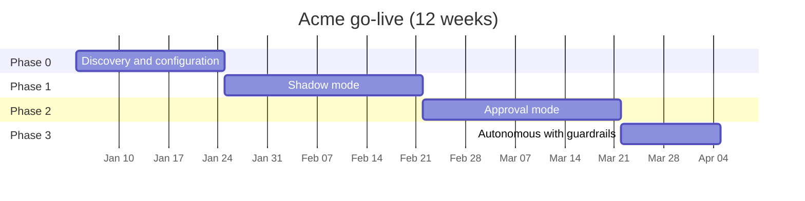

# Go-live plan: Acme Beverage Co.

*Mock deployment (fictional customer). Timeline assumes shortages happen often enough to give us at least one real event, or one replayed past event, per week.*

## The principle

Trust is earned in stages. The agent first works alongside the planners without touching anything, then proposes with every line approved by a person, and only then executes low-risk lines on its own. Each stage has exit criteria agreed with the VP Supply Chain before it starts, and every stage can be rolled back in minutes.

## Phases

| Phase | Weeks | What the agent does | What the planner does | Exit criteria (all must be true) |
|---|---|---|---|---|
| **0. Discovery and configuration** | 1 to 3 | Nothing in production | Confirms the operating rules; signs off the expected answers for the eval scenarios | Rules captured in config; eval scorecard 15 of 15; planners have signed off every expected answer |
| **1. Shadow mode** | 4 to 7 | Runs on every shortage. Nothing executes, no notes are sent | Allocates the usual way, then reviews the agent's plan line by line | At least 4 events compared; 90% of lines within 10% of the planner's quantity, or the difference reviewed and accepted as the better call; no data issue missed; every disagreement explained |
| **2. Approval mode** | 8 to 11 | Its plan is the starting point. Every line waits for a person | Approves or changes each line; sends the drafted notes after reading them | Planner overrides under 10% of lines for 3 events in a row; decisions released the same business day; no distributor complaint traced to an agent note |
| **3. Autonomous with guardrails** | 12 onward | Low-risk lines execute and their notes go out; flagged lines wait in the queue | Works the approval queue (about a third of lines in a typical shortage) | Ongoing: monthly review of overrides, approval thresholds and the scorecard |

**Moving between phases is a config change, not a code change.** The demo app already runs in the Phase 3 shape. Phases 1 and 2 need one setting added in Phase 0: an approval mode of `shadow` (nothing executes), `approve_all` (every line queued) or `thresholds` (today's behavior).

## Timeline

## Risks and mitigations

| Risk | Likelihood | Impact | Mitigation | Already in the demo? |
|---|---|---|---|---|
| **Bad source data** (negative on hand, missing depletions) | High | High: wrong allocations | Markets with impossible values are set aside and flagged, never guessed at; everyone else is still allocated | Yes (eval S10) |
| **Order inflation** by distributors during a shortage | High | Medium | Near-term demand leans on depletions (what consumers buy), not orders | Yes (forecast blend) |
| **Approval fatigue**: the queue is so long that people rubber-stamp it | Medium | High: the human check stops working | Thresholds tuned before go-live: the first draft sent 60% to 100% of lines to a person; the tuned rules send about a third in a typical shortage | Yes |
| **A rule is configured wrong** | Medium | High | Every config change must pass the eval scorecard before it ships; the scorecard catches a disabled hold rule as 70 cases going to the wrong market | Yes (`npm run evals`) |
| **The AI writes something wrong** in a customer email | Low | Medium | Facts come from the engine only; no notes on lines awaiting approval; in approval mode a person reads every note before it goes | Partly (facts and queue rule yes; the human read is Phase 2) |
| **AI outage, refusal or limit hit** | Low | Low | Scripted run of the same tools takes over, clearly labeled; the plan and queue are identical because they don't come from the AI | Yes |
| **Transfers break state rules** | Medium | High: compliance | Every transfer needs approval; transfers can be switched off per customer | Yes |
| **Planners don't trust it** | Medium | High: no adoption | Shadow mode first; every line shows its reasons; disagreements are reviewed together, not argued | Process |
| **Supply problem mistaken for an allocation problem** | Medium | Medium: unfair blame on the agent | Report "markets out if nothing ships" next to "markets out with the plan". In the demo bourbon shortage, the best plan still leaves 14 of 22 markets short because the run is 6 weeks out; that is a production question | Yes (both figures shown) |
| **AI cost runs away** | Low | Low | Saved runs per customer and event, per-visitor rate limit, daily cap; about $0.13 per live run | Yes |

## Rollback plan

| If this happens | Do this | Time to recover |
|---|---|---|
| A config change produces bad plans | Revert the config file to the last version that passed the scorecard. Saved runs are tied to the exact config, so old results can't leak into new ones | Minutes |
| The agent's behavior degrades (new model or prompt) | Pin the previous agent version; the scripted run is always available as a floor | Minutes |
| Trust is shaken by a bad outcome | Drop one phase (for example Phase 3 back to approval mode) with the approval mode setting; review the event with the planners before moving forward again | Same day |
| Full stop | Switch to `shadow`. Planners return to the spreadsheet process, which is kept documented and exercised once a month until Phase 3 has run for a quarter | Same day |

## Roles

| Role | Who | Responsibility |
|---|---|---|
| Executive sponsor | VP Supply Chain | Agrees the exit criteria; approves each phase change |
| Process owner | Planning manager | Owns the rules in the config; approves changes to them |
| Users | Planners | Run shadow comparisons; work the approval queue |
| Deployment lead | Me | Configuration, evals, phase reviews, weekly status |
| Stakeholders | Sales leadership, customer service | Informed of each phase; customer service reviews note wording in Phase 2 |
