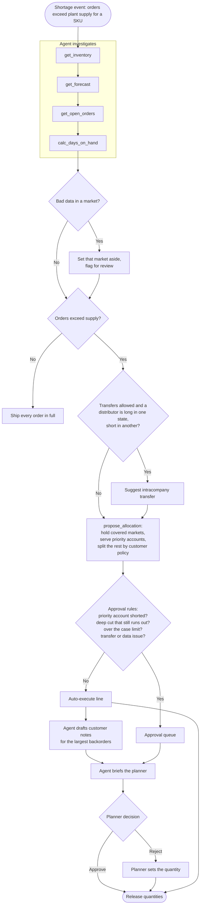

# Workflow map: shortage allocation SOP as an agent workflow

*Mock deployment for Acme Beverage Co. (fictional). This maps the planner's standard operating procedure onto the agent: who does each step, what decision is made, and which line of the customer config controls it.*

## Who does what

| Actor | Role | Can it change a quantity? |
|---|---|---|
| **Agent** (Claude) | Chooses which data to look at, explains each step, drafts customer notes, briefs the planner | No. No tool accepts a quantity |
| **Engine** (tested code) | Calculates days on hand, transfers and the allocation using the customer's rules | Yes, by rule only |
| **Routing code** | Decides which lines need a human, after the agent finishes | No |
| **Planner** | Approves or rejects queued lines; sets quantities on rejected lines | Yes |

## The workflow

## Step by step

| # | Step | Done by | Decision or output | Controlled by (config) | Guardrail |
|---|---|---|---|---|---|
| 1 | Check inventory | Agent, `get_inventory` | Plant supply, next run, on hand and in transit by market | `forecast.inTransitCountsAsOnHandWithinDays` | Read only; scoped to one SKU |
| 2 | Check demand | Agent, `get_forecast` | Blended cases per day by market | `forecast.depletionWeightWeek1` | Read only |
| 3 | Confirm the shortage | Agent, `get_open_orders` | Orders vs supply; fill rate possible | | If not short, everything ships in full |
| 4 | Find who runs out | Agent, `calc_days_on_hand` | Days on hand, cover to the run, markets at risk | | Read only |
| 5 | Screen data | Engine | Negative or impossible values set aside | Always on | Never guesses; flagged to the queue |
| 6 | Intracompany transfers | Engine | Long market sends to short market of the same distributor | `transfers.enabled`, `longThresholdDays`, `leadTimeDays`, `minimumCases` | Every transfer needs approval |
| 7 | Hold covered markets | Engine | Markets covered past the run plus buffer wait | `allocation.holdMarketsCoveredPastRun`, `safetyBuffer.*` | |
| 8 | Priority accounts | Engine | Named accounts served first | `priorityAccounts.rule`, `priorityAccounts.accounts` | Shorted priority accounts need approval |
| 9 | Split the rest | Engine | Equal days of cover, or fair share | `allocation.policy` | Never above the order; never more than supply |
| 10 | Route for approval | Routing code | Queue or auto-execute, with the reason | `approval.*` | Runs after the agent; the agent cannot edit it |
| 11 | Draft customer notes | Agent, `draft_customer_note` | Email for up to 2 auto-executing backorders | `customerEmail.tone`, `customerEmail.signOff` | Facts come from the engine; no note for queued lines; template if AI is down |
| 12 | Brief the planner | Agent | Under 100 words: situation, what's protected, what waits and why | | Only after a plan exists |
| 13 | Decide | Planner | Approve, or reject and set a quantity | | Every queued line needs a person |

## Where today's manual steps went

| Today | With the agent |
|---|---|
| Export orders, depletions and inventory into a spreadsheet | Steps 1 to 4, in seconds |
| Allocate from memory | Steps 5 to 9, written down in the config and tested by 15 eval scenarios |
| Email and phone negotiation with sales | Step 10 sends only the lines that need judgment to a person, with the reason attached |
| Customer service writes notes days later | Step 11, same run, in the customer's chosen tone |
| Nobody can explain a past decision | Every line keeps its reasons; every run keeps its trace |

## What changes for the planner

The planner stops building the allocation and starts reviewing it. In the demo, a typical shortage puts about a third of the lines in front of a person (tequila: 8 of 24 lines plus 2 transfers; sparkling: 7 of 21). A severe shortage puts more there (bourbon: 15 of 22), which is the right behavior: the harder the call, the more it needs a human.
